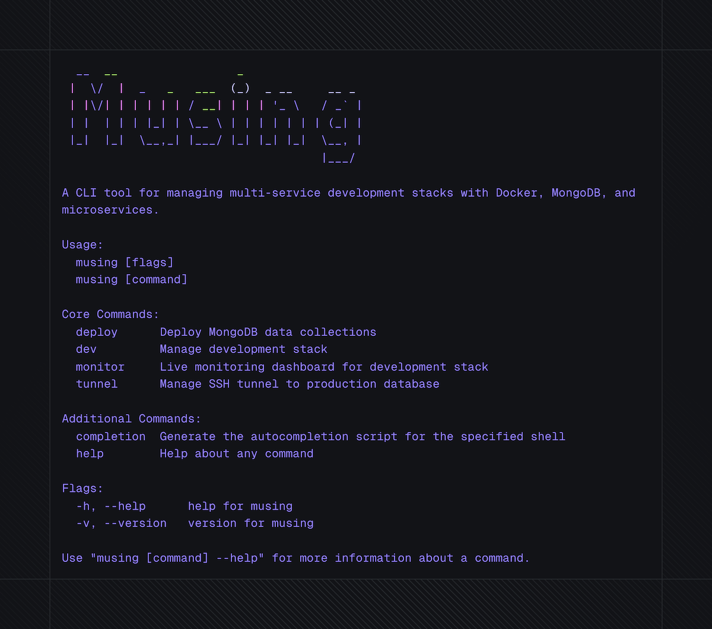
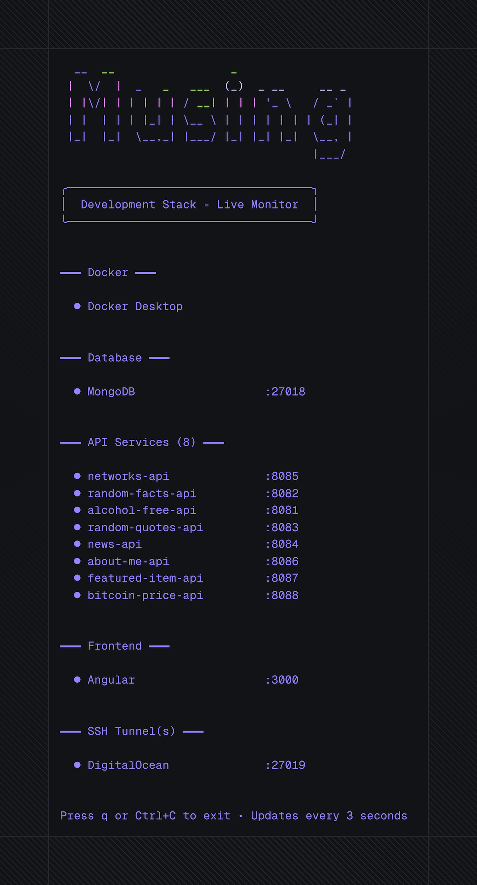

# Musing CLI

A fast command-line tool for managing multi-service development stacks with Docker, MongoDB, SSH tunnels, and port-based service health checks.

## What Does It Do?

This CLI provides professional tooling for complex development environments:

- **Live monitoring dashboard** - Real-time health checks for all services (3-second refresh)
- **Docker stack management** - Start/stop/rebuild services with auto-detection
- **Safe deployments** - MongoDB data sync with confirmations and tunnel verification
- **Beautiful TUI** - Professional terminal UI powered by Charm Bracelet

## My Workflow

This is my DevOps command center for [stevengregory.io](https://stevengregory.io). A tool managing my full-stack application: Angular frontend, Go service layer, and MongoDB database. Built for speedy local development and deployment of decoupled, multi-service stacks.

## Prerequisites

- Docker Desktop and Docker Compose (for `dev`, `monitor`, and logs)
- MongoDB Database Tools, including `mongoimport` (for `deploy`)
- MongoDB Shell, `mongosh` (only when deploying a collection with a configured schema)
- SSH + `lsof` (for `tunnel`, `ssh`, and production deploys)
- `gum` (for styled non-TUI command output)

## Installation

### Homebrew

```bash
brew tap stevengregory/musing
brew install musing
```

Tap repository: `stevengregory/homebrew-musing`

**Upgrading:**

```bash
brew update && brew upgrade musing
```

## Commands

### monitor

Live dashboard with real-time health checks.

```bash
musing monitor
```

**Features:**

- Real-time service health monitoring (3-second refresh)
- Color-coded status indicators for each service
- Organized sections: Docker → Database → API Services → Frontend → SSH Tunnels
- Keyboard controls: `q`, `Ctrl+C`, or `Esc` to exit

### dev

Manage the development stack.

```bash
musing dev           # Start all services
musing dev start     # Start all services (explicit)
musing dev stop      # Stop all services
musing dev rebuild   # Rebuild images and start
musing dev logs      # Follow logs
```

**Features:**

- Auto-detects and starts Docker Desktop if needed
- Validates required repositories exist
- Health checks for database, API services, and frontend
- Progress indicators for long operations

### tunnel

Manage SSH tunnel to production database.

```bash
musing tunnel         # Start tunnel (or show status if running)
musing tunnel start   # Start tunnel explicitly
musing tunnel stop    # Stop tunnel
musing tunnel status  # Check tunnel status
```

**Features:**

- Auto-configures from `.musing.yaml` production settings
- Supports custom SSH key paths with ~ expansion
- Checks if tunnel is already running
- Automatically backgrounds SSH process
- Auto-managed by deploy command for production deployments
- Stops only a single TCP listener whose SSH command matches the configured server, key, and forwarding ports; unrelated or ambiguous processes are left running

Tunnel stop requires production settings and process inspection support (macOS or Linux). Manually started tunnels with different arguments are left running. If the listener cannot be verified, the command returns an error without stopping it.

### ssh

Open an interactive SSH session to your production server.

```bash
musing ssh
```

**Features:**

- Auto-configures from `.musing.yaml` production settings
- Supports custom SSH key paths with ~ expansion
- Interactive shell session for debugging and administration

### deploy

Deploy MongoDB collections to dev or production.

```bash
musing deploy              # All collections to dev
musing deploy news         # Deploy collection or alias to dev
musing deploy news prod    # Deploy collection or alias to prod
```

**How it works:**

- Auto-discovers top-level `.json` files and immediate subdirectories containing `.json` files
- Collection names derive from filenames or directory names (e.g., `news.json` → `news`)
- Hyphenated source keys become underscored collection names (e.g., `blog-posts/` → `blog_posts`)
- API services can define short deploy aliases in `.musing.yaml`
- Automatically detects JSON arrays vs. objects in top-level files
- Treats every JSON file in a directory collection as one document and streams the documents to `mongoimport` in filename order
- Rejects ambiguous sources such as both `blog-posts.json` and `blog-posts/`, or source keys that resolve to the same MongoDB collection
- No hardcoded collection list required

Directory collections are useful when each document deserves isolated source history:

```text
data/
├── news-items.json
└── blog-posts/
    ├── first-post.json
    └── second-post.json
```

Each file under `blog-posts/` must contain exactly one JSON object. Every discovered collection is deployed as a full replacement of its previous contents. Without a configured schema, `mongoimport --drop` performs that replacement.

#### Collection schemas (optional)

Use `database.schemas` to map an exact **source key** to a JSON Schema file. For example, `news-items` identifies `data/news-items.json`; it creates the MongoDB collection `news_items`. A service alias such as `news` resolves to `news-items` before schema selection. Use `news-items` in the mapping, rather than the alias `news`, normalized database name `news_items`, or filename `news-items.json`.

Schema paths resolve from the project root containing `.musing.yaml`, regardless of the directory where `musing` is invoked. Absolute paths are also accepted. Keep schemas outside `database.dataDir`, including through symlinks, so collection discovery cannot import the schemas themselves. Unknown source keys and unsupported schema configuration fail preflight.

A schema file contains one plain JSON Schema object supported by MongoDB's [`$jsonSchema` validator](https://www.mongodb.com/docs/manual/reference/operator/query/jsonschema/), for example `schemas/news-items.schema.json`:

```json
{
  "bsonType": "object",
  "required": ["title"],
  "properties": {
    "title": { "bsonType": "string" }
  }
}
```

The CLI wraps this object in `{ "$jsonSchema": ... }`. Supply the schema object itself, rather than a validator wrapper, collection creation options, index definitions, or validation modes.

Schema numbers must fit finite JavaScript numbers; integer-valued rules must be within the safe integer range, −9007199254740991 through 9007199254740991. Values that would overflow or underflow are rejected during preflight so `mongosh` cannot silently change the configured rule. Ordinary fractional rules are supported.

For a configured collection, deployment:

1. Reads and checks the selected source data and schema, and checks that `mongosh` and `mongoimport` are available. Configured input is captured before database changes; a top-level JSON array must contain objects. For `deploy all`, all selected sources and configured schemas are preflighted before the first collection is changed.
2. Explicitly drops the target collection, allowing a previously absent collection.
3. Recreates it with `validator: { $jsonSchema: ... }`, `validationLevel: "strict"`, and `validationAction: "error"`.
4. Imports the checked data without `--drop` or validation bypass. Imports use `--stopOnError` and `--maintainInsertionOrder`; a creation or import error stops deployment and is returned as a failure, including during `deploy all`.

Unconfigured collections keep their existing import behavior and do not require `mongosh`.

**Replacement is not atomic.** Missing or unreadable schemas, malformed JSON, and unsupported configuration are caught before destructive work. Local parsing does not prove that MongoDB accepts every schema rule or document. A database-side schema error after the drop can leave the collection absent; an import rejection can leave it empty or partially populated. Earlier collections in `deploy all` remain replaced if a later collection fails. This change provides no rollback, staging/swap, or custom-index management.

**Production safety:**

- Interactive confirmation required
- Auto-opens SSH tunnel if not already running
- Auto-closes tunnel after deployment completes
- Clear warnings about data overwrite

### version

Check the installed version.

```bash
musing version
musing --version
```

## Configuration

Create a `.musing.yaml` file alongside `compose.yaml` in your project root to define your stack. Commands search upward from the current directory until they find that project root.

```yaml
# Optional: directory containing API repos.
# Empty defaults to the project root's parent directory.
# Relative values resolve from the project root's parent; absolute and ~/ paths are supported.
apiReposDir: services

services:
  # Frontend
  - name: Angular
    port: 3000
    type: frontend

  # API Services
  - name: my-news-api
    port: 8080
    type: api
    alias: news # Optional: short key for `musing deploy news`
    collection: news-items # Optional: data file or directory key; defaults to alias when omitted

# Database configuration
database:
  type: MongoDB
  name: mydb
  devPort: 27018
  prodPort: 27019
  dataDir: data
  # Optional: exact source key -> plain JSON Schema file, outside dataDir.
  # Relative paths resolve from this project's root, not the caller's directory.
  schemas:
    news-items: schemas/news-items.schema.json

# Optional: Production deployment settings
production:
  server: root@your-server.com # SSH server for production access
  remoteDBPort: 27017 # Remote database port (typically 27017 for MongoDB)
  sshKeyPath: ~/.ssh/your-key # Optional: specific SSH key to use (supports ~ expansion)
```

## Why This Approach?

**Project-agnostic design** means you can adapt it for any stack:

- Works with any frontend framework (Angular, React, Vue, etc.)
- Backend-agnostic (Go, Node, Python microservices)
- `.musing.yaml` driven service definitions
- Docker Compose integration
- Port-based health checking (framework-independent)
- MongoDB deployment patterns
- SSH tunnel support for remote databases

**Key benefits**:

- Fast startup (1-3ms)
- Type-safe Go prevents runtime errors
- Professional terminal UI with Bubble Tea
- Single Go binary; external tools are only needed for the stack operations that use them

## Development

Schema lifecycle tests run without a database. An additional integration test is opt-in and requires an explicitly supplied **disposable local MongoDB instance**, plus `mongosh` and `mongoimport`:

```bash
MUSING_MONGO_INTEGRATION=1 \
MUSING_MONGO_TEST_URI=mongodb://127.0.0.1:27099 \
go test ./internal/mongo -run '^TestMongoSchemaValidatorIntegration$' -v
```

The endpoint must use an explicit loopback host and port, with no credentials, database path, or query string. There is no default endpoint. The test creates and removes its own uniquely named test database and checks valid imports, invalid-document rejection, validator persistence, and repeated full replacement. Leave the opt-in unset for ordinary checks; those skip live database changes.

```bash
# Run without installing
go run ./cmd/musing monitor
go run ./cmd/musing dev

# Test and build
go test ./...
make build

# Manage dependencies
go mod tidy

# Final whitespace check before committing
git diff --check
```

## Architecture

```
musing-cli/
├── cmd/
│   ├── musing/
│   │   └── main.go     # Entry point
│   ├── dev.go          # Dev command
│   ├── deploy.go       # Deploy command
│   ├── monitor.go      # Monitor command
│   ├── ssh.go          # SSH command
│   ├── tunnel.go       # Tunnel command
│   ├── project.go      # Shared project/config loading helpers
│   └── root.go         # Root command setup
├── internal/
│   ├── config/         # Service configs & ports
│   ├── docker/         # Docker operations
│   ├── health/         # Health checks
│   ├── mongo/          # MongoDB deployment
│   └── ui/             # Styled output & prompts
```

**Tech Stack**:

- Go (fast, type-safe, single binary)
- Cobra (command parsing)
- Bubble Tea, Bubbles, and bubble-table (interactive TUI)
- Lip Gloss (terminal styling)
- Huh (confirmation prompts)
- GoReleaser (release packaging)

See [AGENTS.md](AGENTS.md) for Codex guidance and [CLAUDE.md](CLAUDE.md) for additional project background.

## Screenshots

<details>
<summary>Help Command (click to expand)</summary>



</details>

<details>
<summary>Monitor Command (click to expand)</summary>



</details>

## License

MIT
